<!-- Panels are generated by scripts/make_assets.py. Each 
 is one section, so panels inside it
     sit close together and sections get a wider gap. Images that share a row sit on one line with
     no space between them, so the row lines up with the full-width panels. -->

<a href="https://blazexyz.com"></a>
<a href="https://blazexyz.com"></a>

<a href="https://github.com/BlazeXYZ/authtrail"></a><a href="https://github.com/BlazeXYZ/mailsleuth"></a>
<a href="https://github.com/BlazeXYZ/portscan-fingerprint"></a><a href="https://github.com/BlazeXYZ/pwaudit">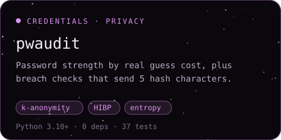</a>


<a href="https://github.com/BlazeXYZ/secret-time-machine"></a><a href="https://github.com/BlazeXYZ/blast-radius"></a>
<a href="https://github.com/BlazeXYZ/fingerprint-mirror"></a><a href="https://github.com/BlazeXYZ/regex-replay"></a>
<a href="https://github.com/BlazeXYZ/pathfinding-playground"></a><a href="https://github.com/BlazeXYZ/termreel"></a>

<b>All ten projects, with live CI status</b>

 

| Project | Layer | The interesting part | CI | Try it |
|---|---|---|---|---|
| [**authtrail**](https://github.com/BlazeXYZ/authtrail) | Host logs | Correlates a brute-forced login with the backdoor account and wiped logs that followed, as one incident timeline |  | — |
| [**MailSleuth**](https://github.com/BlazeXYZ/mailsleuth) | Email | Flags a CEO-fraud email that passes SPF, DKIM *and* DMARC, because the attacker owns the lookalike domain |  | — |
| [**portscan-fingerprint**](https://github.com/BlazeXYZ/portscan-fingerprint) | Network | CPE matching found 39 real CVEs for OpenSSH 8.2p1 where keyword search found 2; includes a hand-written X.509 parser |  | — |
| [**pwaudit**](https://github.com/BlazeXYZ/pwaudit) | Credentials | Prices passwords by what an attacker would spend; breach checks send only 5 of 40 hash characters |  | — |
| [**Secret Time Machine**](https://github.com/BlazeXYZ/secret-time-machine) | Secrets | Replays every commit on every ref; in its demo repo, 4 of the 8 secrets were deleted from the code and are still recoverable from history |  | — |
| [**Blast Radius**](https://github.com/BlazeXYZ/blast-radius) | Supply chain | Flags the 2018 `event-stream` attack even though npm unpublished it; `node-sass` alone drags in 196 packages | 15 tests, `npm test` | [live demo ↗](https://blazexyz.com/blast-radius/) |
| [**Fingerprint Mirror**](https://github.com/BlazeXYZ/fingerprint-mirror) | Privacy | 20 collectors and a stable hash that survives private windows; detects browsers that randomize canvas and audio | no tests yet | [live demo ↗](https://blazexyz.com/fingerprint-mirror/) |
| [**Regex Replay**](https://github.com/BlazeXYZ/regex-replay) | Parsers | A hand-written backtracking engine, checked against `RegExp` on 4,000 fuzzed cases, that shows ReDoS step by step |  | — |
| [**Pathfinder Playground**](https://github.com/BlazeXYZ/pathfinding-playground) | Algorithms | Six algorithms on real streets; every optimal one matches Dijkstra on 100 random routes | 9 tests, `npm test` | [live demo ↗](https://blazexyz.com/pathfinding-playground/) |
| [**termreel**](https://github.com/BlazeXYZ/termreel) | Dev tools | Its own VT emulator and a CSS filmstrip; prefix chaining and a separate cursor track halved the sample SVG | 35 tests | — |

<b>What the four tools have in common</b>

 

- **Standard library only.** No `pip install`, no supply chain. Each tool includes its own parsers: DER certificates, syslog, email headers.
- **Hostile input is the default.** Scan banners, email headers and SSH usernames are all attacker-controlled. Every report is escaped and ships with no JavaScript.
- **Never falsely safe.** When a check can't run, the tool says "unavailable", never "clean".
- **Mapped to MITRE ATT&CK**, so findings come out in the vocabulary defenders already use.
- **Tested like they matter.** CI on Linux and Windows, plus regression tests for the real bugs found along the way, such as a BOM that made `password` look strong and a regex silently broken by a backspace byte.

<a href="https://blazexyz.com"></a>


Security tools here are for systems you own or are authorized to test.

