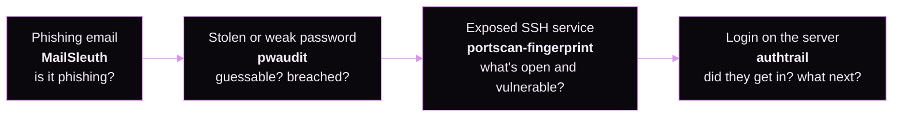

<div align="center">

<a href="https://blazexyz.com"></a>

<br>

[](https://blazexyz.com)
[](https://discord.com/users/766780065198899210)
[](https://exypnos.one/christian-block)

</div>


```yaml
name:      Blaze
pronouns:  she / her
role:      Board member, Exypnos One Corp.
focus:     QA, bug hunting, counsel
building:  security tools for defenders · blazexyz.com · a Minecraft mod
likes:     dot art, black holes, shaders, web design, minecraft modding
```

## Security toolkit

Four small, dependency-free Python tools, each aimed at a different layer of defense. Each one goes past the obvious answer: an open port isn't a finding until you match it to a CVE, passing DMARC doesn't make an email safe, a strength meter's "entropy" is usually wrong, and a thousand failed logins matter less than the one that succeeded.

<div align="center">

<a href="https://github.com/BlazeXYZ/authtrail"></a>
<a href="https://github.com/BlazeXYZ/mailsleuth"></a>
<a href="https://github.com/BlazeXYZ/portscan-fingerprint"></a>
<a href="https://github.com/BlazeXYZ/pwaudit"></a>

</div>

### One attack, four tools

Together they follow a single intrusion from start to finish:



| Project | Layer | The interesting part | Status |
|---|---|---|---|
| [**authtrail**](https://github.com/BlazeXYZ/authtrail) | Host logs | Correlates a brute-forced login with the backdoor account and wiped logs that followed, as one incident timeline | [](https://github.com/BlazeXYZ/authtrail/actions/workflows/tests.yml) |
| [**MailSleuth**](https://github.com/BlazeXYZ/mailsleuth) | Email | Flags a CEO-fraud email that passes SPF, DKIM *and* DMARC, because the attacker owns the lookalike domain | [](https://github.com/BlazeXYZ/mailsleuth/actions/workflows/tests.yml) |
| [**portscan-fingerprint**](https://github.com/BlazeXYZ/portscan-fingerprint) | Network | CPE matching found 39 real CVEs for OpenSSH 8.2p1 where keyword search found 2; includes a hand-written X.509 parser | [](https://github.com/BlazeXYZ/portscan-fingerprint/actions/workflows/tests.yml) |
| [**pwaudit**](https://github.com/BlazeXYZ/pwaudit) | Credentials | Prices passwords by what an attacker would spend; breach checks send only 5 of 40 hash characters | [](https://github.com/BlazeXYZ/pwaudit/actions/workflows/tests.yml) |

<details>
<summary><b>What they have in common</b></summary>
<br>

- **Standard library only.** No `pip install`, no supply chain. Each tool includes its own parsers: DER certificates, syslog, email headers.
- **Hostile input is the default.** Scan banners, email headers and SSH usernames are all attacker-controlled. Every report is escaped and ships with no JavaScript.
- **Never falsely safe.** When a check can't run, the tool says "unavailable", never "clean".
- **Mapped to MITRE ATT&CK**, so findings come out in the vocabulary defenders already use.
- **Tested like they matter.** CI on Linux and Windows, plus regression tests for the real bugs found along the way, such as a BOM that made `password` look strong and a regex silently broken by a backspace byte.

</details>

## Also building

| | |
|---|---|
| 🌌 **[blazexyz.com](https://blazexyz.com)** | My site: a three.js black hole, galaxy and highway behind liquid-glass panels, with dot-matrix type and live Discord presence. Next.js, React Three Fiber, React Spring, custom GLSL. |
| ⛏️ **Shadow Slave** | A Fabric mod for Minecraft. |

## Tools I reach for

<div align="center">


</div>


<div align="center"><sub>Security tools here are for systems you own or are authorized to test.</sub></div>
